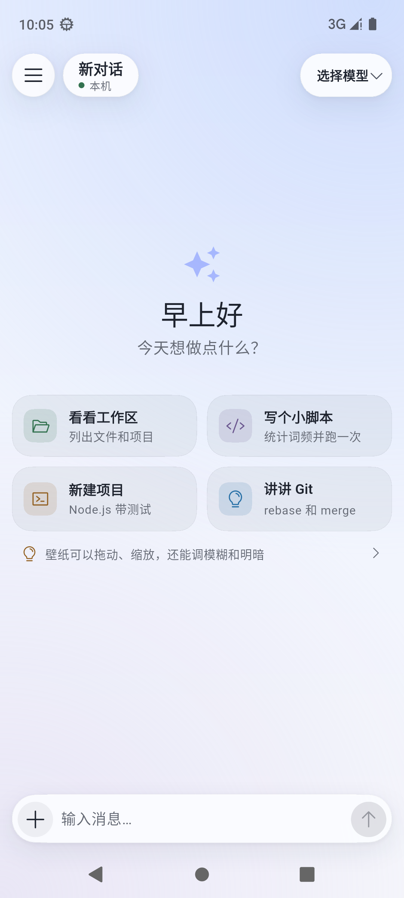

# Agent Mobile

**Chat with AI on Android and pick up work from your computer.**

Agent Mobile is the Android client for Agent Desktop. Sign in with the same account to share your membership, credits, and official models across both apps under the same brand. Once paired, switch to your computer from the chat sidebar to resume a desktop conversation or start a new task.

[Download DreamYu Agent for Android](https://agent.mengyulab.cn/api/client/android-download/mengyu-agent/file) · [Quick start](#quick-start) · [Development and builds (Chinese)](docs/AGENT_MOBILE.md) · [简体中文](README.md)

## Features

- **Chat directly on your phone.** Available official models sync automatically after sign-in. Chat supports streaming replies and Markdown, and you can send images when the selected model supports image input.
- **Share one account across devices.** Use the same account, membership, and credits in both apps under the same brand. Create an account on your phone if your brand enables self-service registration.
- **Continue work on your computer.** Pair using a QR code or a pairing code, then switch between your phone and the paired computer in the same chat interface. Browse desktop history, choose a working folder, and start or resume sessions that run on your computer. Follow live replies, respond to tool approval requests, and choose from the models, skills, experts, and modes supported by your desktop client.
- **Ship a branded app.** Brand operators can set their own app name, icon, and accent color, with independent Android application IDs, versions, and updates.

## App preview

*New chat in the DreamYu Agent edition.*

## Quick start

1. Install the Android app from the [DreamYu download page](https://agent.mengyulab.cn/api/client/android-download/mengyu-agent/file) and sign in with the account you use on Agent Desktop. Start chatting once your models have synced.
2. To resume work on your computer, open the mobile entry in the Agent Desktop sidebar and enable remote collaboration. On your phone, scan the QR code shown on your computer or enter the pairing code.
3. Switch to the paired computer from the mobile chat sidebar, then open a past conversation or start a new one. Keep Agent Desktop online while connected.

## Development and feedback

The [development and build guide (Chinese)](docs/AGENT_MOBILE.md) covers the Android toolchain, branded builds, and releases. Report problems or suggest improvements on [GitHub Issues](https://github.com/mengyuxuezhang/Agent-Mobile/issues). If Agent Mobile is useful to you, give the repository a Star.

## License

Agent Mobile is released under the [AGPL-3.0](LICENSE). It builds on [dsh-Go](https://github.com/ccch1mneyyy/dsh-Go) by ccch1mneyyy. See the [third-party notices](THIRD_PARTY_NOTICES.md) and [asset licensing notes](ASSETS.md) for component and asset licenses.
