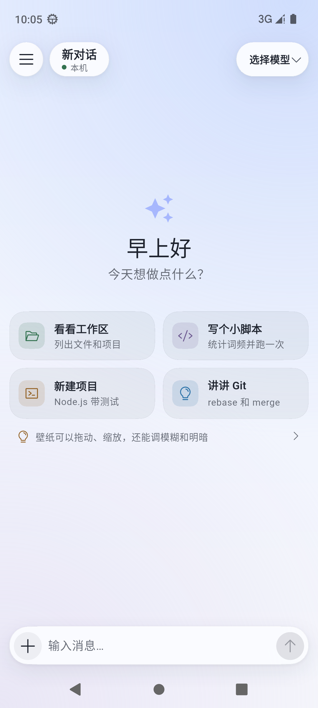

# Agent Mobile

**在 Android 手机上使用 AI，也能接着处理电脑上的工作。**

Agent Mobile 是 Agent Desktop 的 Android 客户端。使用同一品牌账号登录，手机和电脑即可共享会员、积分与官方模型。配对后，从聊天侧栏切换到电脑，就能接续桌面会话或新建任务。

[下载梦羽 Agent Android 版](https://agent.mengyulab.cn/api/client/android-download/mengyu-agent/file) · [快速上手](#快速上手) · [开发与构建](docs/AGENT_MOBILE.md) · [English](README.en.md)

## 功能亮点

- **手机直接聊天**。登录后自动同步可用的官方模型。支持流式回复和 Markdown，所选模型支持图片输入时可在对话中发图。
- **同一账号和权益**。手机与桌面共用同一品牌下的账号、会员和积分。品牌开放自助注册时，可以直接在手机上创建账号。
- **接续电脑上的工作**。通过二维码或配对码连接，在同一个聊天界面切换本机和已配对的电脑。在手机上查看桌面历史、选择工作目录、新建或继续会话，任务由电脑执行。手机端可查看实时回复、处理工具审批，并选择桌面端支持的模型、技能、专家和模式。
- **按品牌独立发行**。品牌方可以使用自己的应用名称、图标和配色，独立管理 Android 包名、版本和更新。

## 应用预览

*梦羽 Agent 品牌版的新对话界面。*

## 快速上手

1. 从[品牌下载页](https://agent.mengyulab.cn/api/client/android-download/mengyu-agent/file)安装 Android 版，使用和桌面端相同的品牌账号登录。模型同步后即可在手机上开始对话。
2. 要继续电脑上的工作，在 Agent Desktop 左侧栏打开「手机端」，开启远程协作。在手机上扫描电脑显示的二维码或输入配对码。
3. 从手机聊天侧栏切换到已配对的电脑，打开历史会话或新建会话。远程使用时请保持桌面客户端在线。

## 开发与反馈

[开发与构建指南](docs/AGENT_MOBILE.md)介绍 Android 工具链、品牌打包和发布流程。遇到问题或有使用建议，欢迎到 [GitHub Issues](https://github.com/mengyuxuezhang/Agent-Mobile/issues) 反馈。如果 Agent Mobile 对你有用，也欢迎给仓库点个 Star。

## 开源许可

Agent Mobile 按 [AGPL-3.0](LICENSE) 发布。项目基于 ccch1mneyyy 的 [dsh-Go](https://github.com/ccch1mneyyy/dsh-Go) 构建，感谢上游贡献。第三方组件及素材的许可详见[第三方声明](THIRD_PARTY_NOTICES.md)和[素材授权说明](ASSETS.md)。
